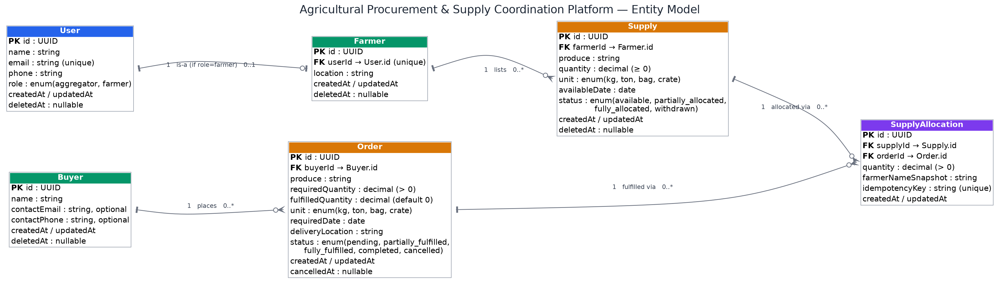
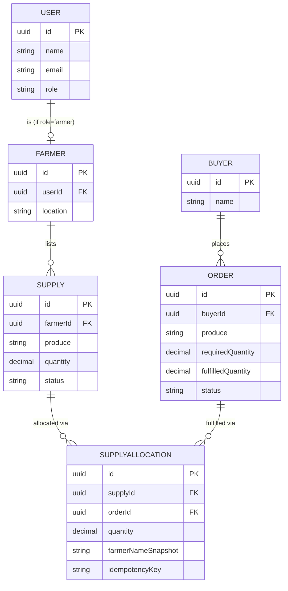
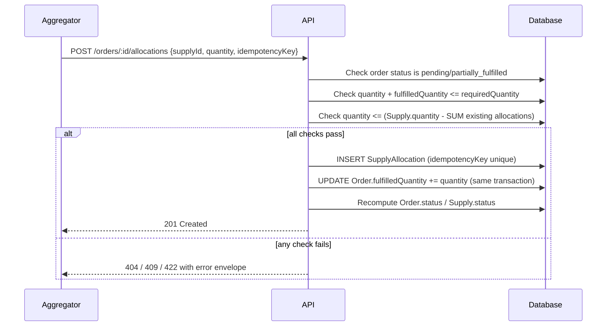

# 2. Entity Model

## Entities

### User — anyone who can log into the system

| Field | Type | Required |
|---|---|---|
| id | UUID | yes |
| name | string | yes |
| email | string, unique | yes |
| phone | string | yes |
| role | enum(aggregator, farmer) | yes |
| createdAt | timestamp | yes |
| updatedAt | timestamp | yes |
| deletedAt | timestamp, nullable | no |

### Farmer — the supply-side profile attached to a `farmer`-role User

| Field | Type | Required |
|---|---|---|
| id | UUID | yes |
| userId | UUID (FK → User), unique | yes |
| location | string | yes |
| createdAt | timestamp | yes |
| updatedAt | timestamp | yes |
| deletedAt | timestamp, nullable | no |

### Buyer — the party an order is placed on behalf of

| Field | Type | Required |
|---|---|---|
| id | UUID | yes |
| name | string | yes |
| contactEmail | string | no |
| contactPhone | string | no |
| createdAt | timestamp | yes |
| updatedAt | timestamp | yes |
| deletedAt | timestamp, nullable | no |

### Supply — a quantity of produce a farmer has made available

| Field | Type | Required |
|---|---|---|
| id | UUID | yes |
| farmerId | UUID (FK → Farmer) | yes |
| produce | string | yes |
| quantity | decimal | yes |
| unit | enum(kg, ton, bag, crate) | yes |
| availableDate | date | yes |
| status | enum(available, partially_allocated, fully_allocated, withdrawn) | yes |
| createdAt | timestamp | yes |
| updatedAt | timestamp | yes |
| deletedAt | timestamp, nullable | no |

### Order — a buyer's request for a quantity of produce

| Field | Type | Required |
|---|---|---|
| id | UUID | yes |
| buyerId | UUID (FK → Buyer) | yes |
| produce | string | yes |
| requiredQuantity | decimal | yes |
| fulfilledQuantity | decimal | yes (defaults to 0 — see `04-design-decisions.md §1`, denormalization #2) |
| unit | enum(kg, ton, bag, crate) | yes |
| requiredDate | date | yes |
| deliveryLocation | string | yes |
| status | enum(pending, partially_fulfilled, fully_fulfilled, completed, cancelled) | yes |
| createdAt | timestamp | yes |
| updatedAt | timestamp | yes |
| cancelledAt | timestamp, nullable | no |

### SupplyAllocation — the join record connecting a Supply listing to an Order, in a specific quantity

This is the entity that makes the Supply ↔ Order relationship
many-to-many.

| Field | Type | Required |
|---|---|---|
| id | UUID | yes |
| supplyId | UUID (FK → Supply) | yes |
| orderId | UUID (FK → Order) | yes |
| quantity | decimal | yes |
| farmerNameSnapshot | string | yes (set at creation — see `04-design-decisions.md §1`, denormalization #1) |
| idempotencyKey | string, unique | yes |
| createdAt | timestamp | yes |
| updatedAt | timestamp | yes |

## Relationships & cardinality

- User **1 : 1** Farmer (only for `farmer`-role users)
- Farmer **1 : many** Supply
- Buyer **1 : many** Order
- Order **1 : many** SupplyAllocation
- Supply **1 : many** SupplyAllocation
- Order **many : many** Supply, *through* SupplyAllocation (one order is
  typically fulfilled from several farmers' supply, and a single supply
  listing may be split across several orders)

## Entity-relationship diagram

Rendered image files: [`diagrams/entity-relationship-diagram.png`](diagrams/entity-relationship-diagram.png) ·
[`diagrams/entity-relationship-diagram.svg`](diagrams/entity-relationship-diagram.svg) (vector, scales cleanly) ·
source: [`diagrams/entity-relationship-diagram.dot`](diagrams/entity-relationship-diagram.dot) (Graphviz — edit and re-render with `dot -Tpng entity-relationship-diagram.dot -o entity-relationship-diagram.png`).

Mermaid source (renders automatically on GitHub if you prefer this form instead of the static image):

## Allocation flow (how a request becomes a state change)

