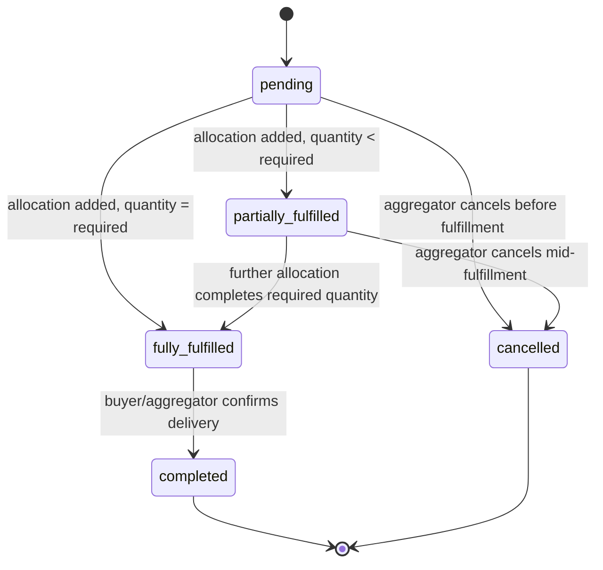
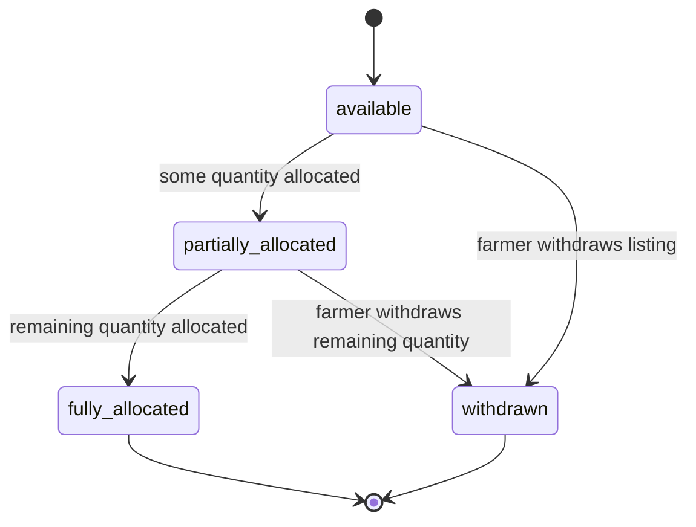

# 4. The Seven Hard Questions

## 4.1 Normalization

**Denormalization #1 — `SupplyAllocation.farmerNameSnapshot`.**
An allocation is a historical fulfillment record used to answer "who
actually supplied this order" for disputes and traceability
**[Action 4, Action 5]**. If a farmer's account name is later corrected or
the farmer leaves the platform, the allocation record must still reflect
who the aggregator was actually dealing with at the time the allocation was
made. Looking this up live from the current Farmer row would silently
rewrite history. Trade-off: a small amount of extra storage and a snapshot
write at allocation-time, in exchange for an allocation record that never
changes underneath a completed transaction.

**Denormalization #2 — `Order.fulfilledQuantity`.**
Tracking order fulfillment **[Action 5]** is the highest-traffic read in
the product — an aggregator or buyer checking "how much is left to source"
happens far more often than an allocation is written. Recomputing
`SUM(SupplyAllocation.quantity) WHERE orderId = ?` on every order-detail
read would be wasteful at scale. Instead, `fulfilledQuantity` is maintained
as a rolling total, updated in the same transaction that writes a new
SupplyAllocation row, trading a small write-time cost for a cheap,
indexable, single-row read.

Everything else stays normalized: the farmer's current name/location lives
only on Farmer, the buyer's contact details live only on Buyer, and Supply
does not duplicate anything about the Farmer beyond the foreign key.

## 4.2 Money

**This MVP does not model money.** The core workflow — an aggregator
matching buyer demand against fragmented farmer supply — is about
*quantity* fulfillment, not payment processing; no entity in this design
carries a price, a monetary amount, or a currency. This is a deliberate
scope decision, not an oversight: adding pricing/settlement fields the
product doesn't yet act on would be unjustified complexity, and worse,
would invite exactly the kind of float/decimal money bugs the "smallest
unit" rule exists to prevent.

**If a future phase introduces pricing** (e.g. a per-unit rate on Supply,
or a settlement amount on an Order), it must follow the same rule this
project would use for any money field: every monetary value stored as a
whole integer in the smallest currency unit (e.g. kobo, not naira),
alongside an explicit ISO-4217 currency code column — never a decimal or
float.

## 4.3 Status & state machines

### Order lifecycle

Forbidden transitions: `completed → *` (any transition out of a terminal
state), `cancelled → *`, `fully_fulfilled → partially_fulfilled`
(fulfillment can only move forward — an order cannot "un-fulfill" itself),
`fully_fulfilled → pending`. Enforced at the **application layer** via an
explicit allow-list of transitions checked before every status update, and
backstopped at the **database layer** with a check constraint that rejects
any row where `cancelledAt IS NOT NULL AND status != 'cancelled'`, and
another requiring `fulfilledQuantity <= requiredQuantity` at all times — so
a direct SQL write can't silently corrupt a terminal or over-fulfilled
record either.

### Supply lifecycle

Forbidden: `fully_allocated → available` (would imply quantity increased
without a new Supply record being created), `withdrawn → *`. Enforced the
same way — an application-level transition guard, plus a check constraint
requiring the sum of a supply listing's active allocations never to exceed
its `quantity` (see §4.6).

## 4.4 Time

Every entity has `createdAt` and `updatedAt`. Soft-delete vs. hard-delete
decisions:

| Entity | Delete strategy | Reason |
|---|---|---|
| User | Soft delete | Account history should remain attributable even after a user leaves the platform |
| Farmer | Soft delete | Historical Supply and SupplyAllocation records must keep a valid reference even after a farmer stops supplying |
| Buyer | Soft delete | Historical Order records must keep a valid reference after a buyer relationship ends |
| Supply | Soft delete | A withdrawn listing may already have allocations against it; the listing must stay resolvable for those allocation records |
| Order | Never deleted | Historical orders are the record of what was actually requested and fulfilled; only `status` changes (e.g. to `cancelled`), the row itself is permanent |
| SupplyAllocation | Never deleted | This is the audit trail of what was actually supplied against what order; correcting a mistaken allocation requires a new adjusting record, not deleting the old one |

## 4.5 Identifiers

All identifiers are generated (UUIDs), never sequential auto-increment
integers. Sequential IDs let any client enumerate the entire dataset by
incrementing a number in the URL (`/orders/1`, `/orders/2`, ...), exposing
other buyers' order details and other farmers' supply data with no
authorization check required beyond guessing.

## 4.6 Constraints

| Table | Constraint | Invalid state made impossible |
|---|---|---|
| Farmer | Unique on `userId` | A single User cannot have two Farmer profiles |
| Supply | FK `farmerId → Farmer.id` | A supply listing cannot exist without an owning farmer |
| Supply | Check: `quantity >= 0` | A supply listing cannot claim a negative available quantity |
| Order | FK `buyerId → Buyer.id` | An order cannot exist without a buyer |
| Order | Check: `requiredQuantity > 0` | An order cannot request a zero or negative quantity |
| Order | Check: `fulfilledQuantity <= requiredQuantity` | An order can never be recorded as over-fulfilled |
| Order | Check: `cancelledAt IS NOT NULL` only when `status = 'cancelled'` | A cancelled order's timestamp and status can't disagree |
| SupplyAllocation | FK `supplyId → Supply.id`, FK `orderId → Order.id` | An allocation cannot reference a nonexistent supply listing or order |
| SupplyAllocation | Check: `quantity > 0` | A zero or negative-quantity allocation cannot be recorded |
| SupplyAllocation | Unique on `idempotencyKey` | A duplicate allocation request cannot double-allocate the same intent |
| SupplyAllocation | Application-layer + trigger check: `SUM(quantity) WHERE supplyId = ? <= Supply.quantity` | A supply listing cannot be allocated beyond what actually exists |

The last constraint is the one the original workflow analysis calls out
explicitly: allocating 1,000 kg against a listing that only has 500 kg
remaining must never silently succeed. It is enforced in the application
layer before the allocation is written, and backstopped by a database
trigger that recomputes the allocated sum on insert/update and rejects the
write if it would exceed `Supply.quantity` — so a direct SQL write can't
bypass it either.

## 4.7 Indexes

| Action | Query it serves | Index |
|---|---|---|
| [Action 1] Create a buyer order | Look up the buyer being ordered for | Primary key index on `Buyer.id` (default) |
| [Action 2] Add/update farmer supply | Find a farmer's own listings | Composite index on `Supply(farmerId, status)` |
| [Action 3] View available supply | Find available supply by produce type | Composite index on `Supply(produce, status)` |
| [Action 4] Allocate supply | Find allocations for a given supply listing (to sum against `quantity`) | Index on `SupplyAllocation(supplyId)` |
| [Action 5] Track order fulfillment | Find allocations for a given order | Index on `SupplyAllocation(orderId)` |
| Buyer order history (supporting list view) | Paginate a buyer's past orders, newest first | Composite index on `Order(buyerId, createdAt DESC)` |
